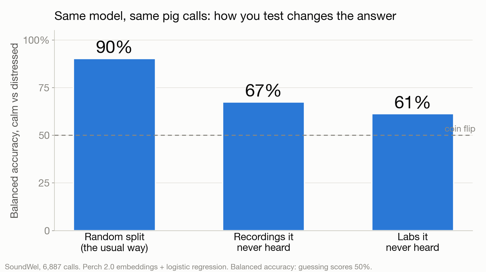

# Oinkalytics

> We taught AI to hear when animals are stressed, before it costs the planet.

Oinkalytics listens to pig calls and decides whether each one sounds **calm**, **distressed**, or **"I'm not sure"**, with a calibrated confidence and a reason based on what it measured. When a pen starts to sound distressed, it texts the farmer over iMessage. The farmer can reply **"why?"** for the evidence or **"play it"** to hear the call.

Built in 30 hours at HackHarvard 2026 for the ASUS "Save the Earth" track, with [Photon](https://photon.codes) as the messaging layer.

## Why it matters

Every animal that gets sick or dies before market has already used feed, water and land, and produced emissions, with no food to show for it. Stress shows up in a pig's voice before anyone sees it, and published work shows pig calls carry emotional valence (Briefer et al. 2022). A cheap microphone can listen to every pen at once; a farmer can't.

## What we found (the honest version)

We test only on **recordings the model never heard**, and we show how much the usual shortcut inflates the result.



| Test | Balanced accuracy (chance = 50%) |
|---|---|
| Random split (how most demos report it) | **90%**, matching the published 91.5% |
| Recordings it never heard (leave-session-out) | **67%** |
| Labs it never heard (leave-team-out) | **61%** |
| When it's allowed to say "not sure" (decides 64% of calls) | **75%** on the calls it answers |

- **Its confidence is honest.** When it says 80% sure, it's right about 80% of the time (calibration error 0.02). See [chart](docs/slides/2_calibration.png).
- **Same pig, two moods.** On a second dataset with pig IDs, the model scores 86% on pigs it never heard, the same as a random split. Within one setting it hears mood, not individual pigs. The drop to 67% comes from differences between recordings and labs, which is why a real-barn test is our next step.
- **It knows what isn't a pig.** Claps, coughs and other everyday sounds return "I'm not sure this is a pig call". It rejected 100% of held-out non-pig clips.
- **Farm noise.** We mixed held-out calls with farm noise. The first model got overconfident, so we retrained it with half the noise recordings and tested on the other half: in noise louder than the call, false alarms on calm pigs fell from 31% to 14% and it says "not sure" more instead of guessing. See [chart](docs/slides/6_noise.png).
- **Three species, three shortcuts caught.** Pigs: a random split inflates 67% to 90% (lab differences). Chickens: 99.6% that simple loudness features nearly match (recording differences). Fruit bats (Prat et al. 2017, CC0): spotting aggression in bats it never heard is 55%, and time of day alone predicts it better than the model (AUC 0.87 vs 0.85). See [chart](docs/slides/7_bats.png). We report what holds up.
- **What we don't claim:** that it works in a real barn (we tested added noise, not barn echo or distance), that it cuts emissions by a specific amount (unmeasured), that it works on other species (on wild boar it scored *below* chance), or that it understands what pigs "mean". It predicts whether a call came from a positive or negative situation.

Full working notes: [docs/DECISIONS.md](docs/DECISIONS.md).

## How it works

```
pig call (any audio) ─▶ ffmpeg ─▶ Perch 2.0 embedding ─▶ calibrated classifier ─▶ calm / distressed / not sure
                                        │                                                │
                                        ├─▶ "is this a pig?" check (vs ESC-50)           ├─▶ barn dashboard (Gradio)
                                        └─▶ 3 most similar calls from other recordings   └─▶ pen alerts ─▶ iMessage bot (Photon)
                                                                                                         "why?" → evidence-only LLM explanation
```

- **Embeddings:** Google's Perch 2.0 bioacoustics model, averaged over only the part of the clip that contains the call.
- **Classifier:** logistic regression with temperature scaling. A call is "distressed" only above a threshold chosen to keep false alarms on calm calls near 20%. Otherwise it's "calm" or "not sure".
- **Explanations:** measured features (duration, pitch, loudness…) plus the nearest calls go to an LLM as JSON. Its output is checked for any number not in the evidence; if anything strays, we fall back to a template.
- **Alerts:** a pen alerts when 3 of its last 5 confident calls are distressed, at most once per pen every few minutes.

| Folder | What's in it |
|---|---|
| `ml/` | data, embeddings, evaluation, training, evidence and explanations |
| `api/` | FastAPI server (the contract is in `api/schemas.py`, docs in [docs/API.md](docs/API.md)) |
| `dashboard/` | Gradio barn dashboard and simulator |
| `bot/` | Photon iMessage agent (TypeScript, spectrum-ts) |
| `docs/` | plan, decisions log, slides |

## Run it

Needs macOS or Linux, Python 3.10+, Node 24+, ffmpeg.

```bash
cp .env.example .env                       # OpenRouter key; Photon project ID + secret for iMessage
python3 -m venv .venv && .venv/bin/pip install -r requirements.txt

# one-time: data, embeddings, models (~40 min, mostly downloads)
#   SoundWel (Zenodo 8252482) -> data/raw/soundwel/, ESC-50 -> data/raw/esc50/
.venv/bin/python -m ml.labels
.venv/bin/python -m ml.embed data/manifest_soundwel.csv data/emb/soundwel.npz
.venv/bin/python -m ml.embed data/manifest_esc50.csv data/emb/esc50.npz
.venv/bin/python -m ml.train_final

# run
.venv/bin/uvicorn api.server:app --port 8000      # API
.venv/bin/python dashboard/app.py                 # dashboard on http://localhost:7860
cd bot && npm install && npm run dev              # iMessage bot (BOT_CHANNEL=terminal for a local chat)
```

No model or data? `uvicorn api.mock_server:app --port 8000` serves the same API with fake predictions.

## Data and credits

- **SoundWel** pig vocalization database (6,887 calls, 17 contexts), Zenodo 8252482, CC BY 4.0. Briefer, E.F. et al. (2022), *Classification of pig calls produced from birth to slaughter according to their emotional valence and context of production*, Scientific Reports.
- **Ungulate valence calls** (pig subset with animal IDs), Zenodo 14636641, CC BY 4.0. Lefèvre, Sypherd & Briefer (2025).
- **ESC-50** environmental sounds, Piczak (2015), CC BY-NC 3.0, used only to test "not a pig".
- **Perch 2.0**, Google DeepMind / Google Research.

## Next steps

1. Record with cheap microphones on a partner farm and measure accuracy in real noise.
2. Let the bot ask farmers to label the calls it's least sure about.
3. New species, each with its own labelled calls, since our model doesn't transfer to wild boar.
